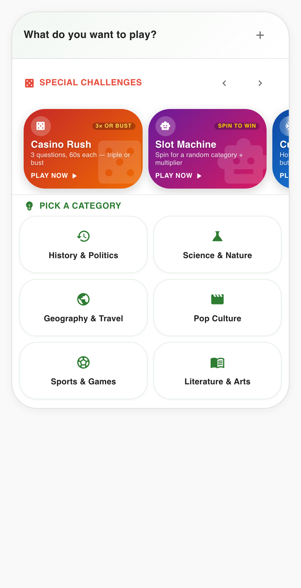
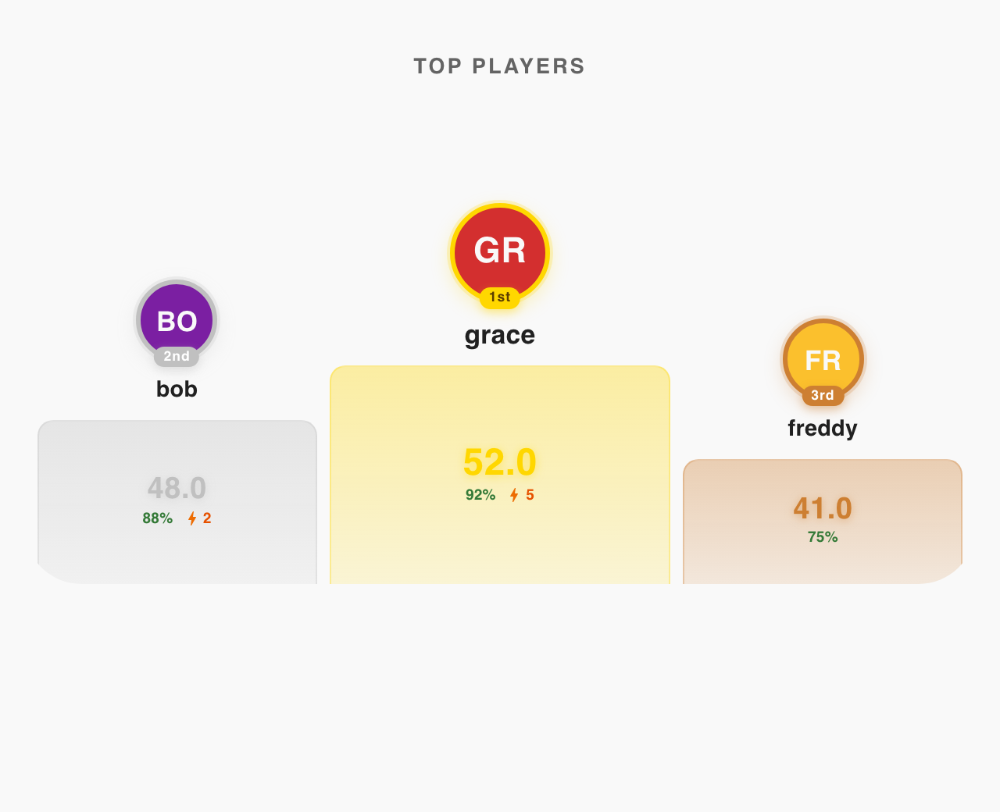
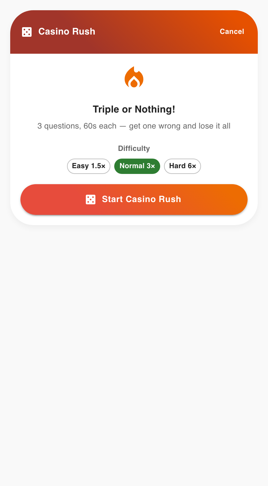
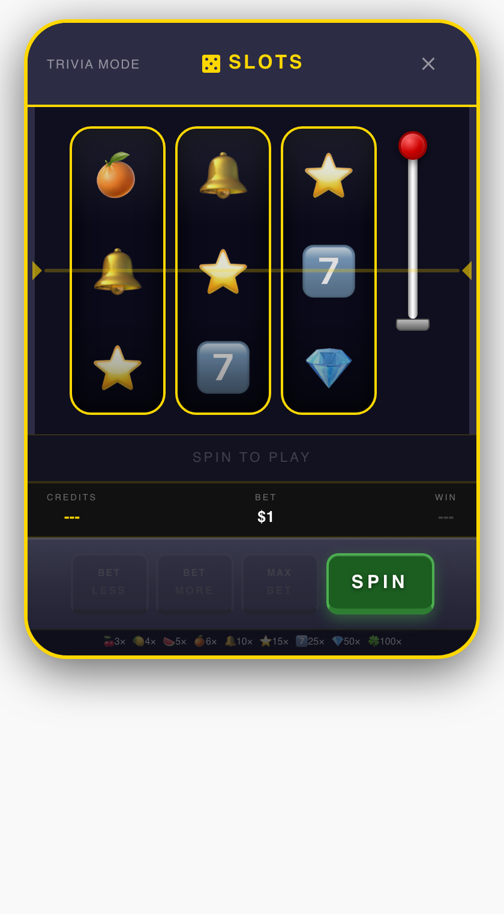
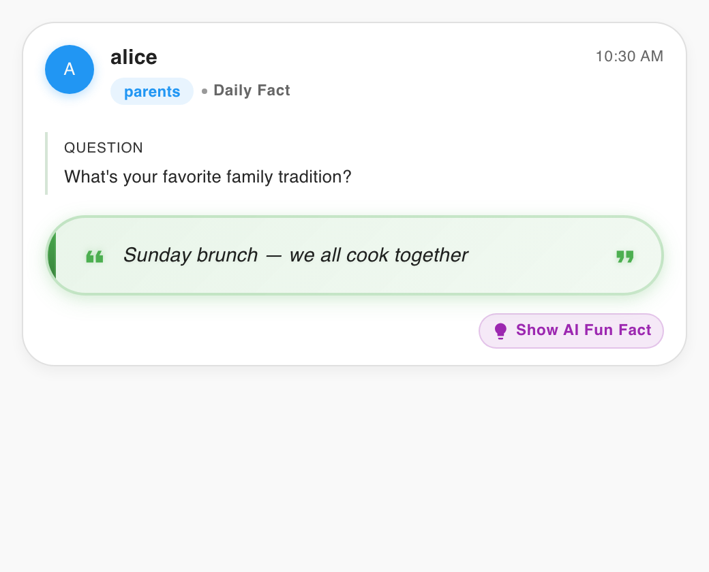
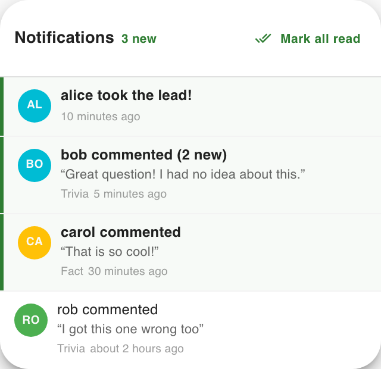
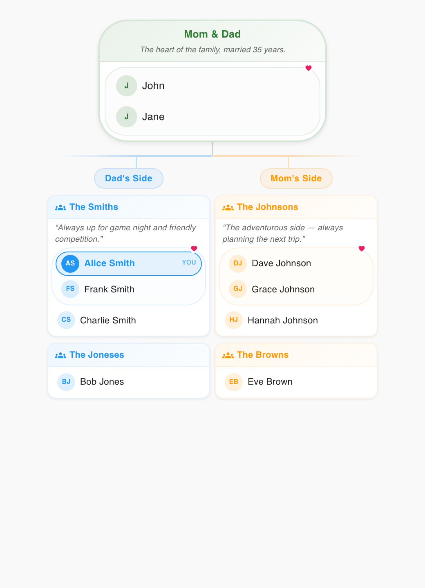

# Family Trivia

> _"Assume everyone is trying their best, and be kind to each other."_
> — Christina Baker Kline

AI-powered daily trivia, facts, and mini-games for families — built with React, AWS CDK, and Claude on Bedrock.

---

## In memory of…

<div align="center">

**Elizabeth "Betty" D'Hondt**

_1946 — 2026_

_She cared deeply, for every creature, for every story,_
_with a heart as big as the elephants she loved._

</div>

This project started as a way to stay connected with my mom. After retirement, as her physical health declined, I watched depression slowly take more of her light. I'd sit with her, listen, try to be there — sometimes love looks like a hard balance between helping, giving space, and simply showing up. Family Trivia gave her something to do every morning, gave us something to talk about, and helped us capture more memories of our family, together.

May is **#MentalHealthMonth** 💚. Mental health struggles can be quiet — isolation, loss of identity, feeling like a burden when you're deeply loved. Check in, sit awhile, and make space for the conversations that matter. Let's have more good days, together.

Resources: [mhanational.org/may](https://mhanational.org/may)

**#WordsToRememberForNana**

---

## What it does

- **Daily Trivia** — One AI-generated question per day per player, with catch-up mode for missed days.
- **Daily Facts** — Share personal facts with the family. Weekly AI summaries.
- **Game Modes** — Casino Rush, Slot Machine, Curling, Tetris. Each earns a trivia score multiplier.
- **Arcade** — Same games, unlimited play, high-score leaderboards.
- **Family Feud** — Rotating "how well do you know me?" rounds.
- **Leaderboard** — Season-based scoring, individual + team rankings.
- **Notifications** — Comments, high scores, leader changes, Family Feud results.
- **Timeline** — Scrollable feed of everyone's answers and facts, with threaded comments.

## A look at it

|  |  |
|---|---|
|  |  |
| **Daily trivia & game-mode carousel** — pick a category or jump into a special challenge. | **Top players** — season-based podium with score, accuracy, and streak. |
|  |  |
| **Casino Rush** — 3 questions, 60s each. Triple-or-bust difficulty multipliers. | **Slot Machine** — spin a random category and multiplier. |
|  |  |
| **Daily Facts** — share something about yourself. AI generates a fun-fact follow-up. | **Notifications** — comments, leader changes, Family Feud results. |



_Screenshots are captured from Storybook stories — see [`scripts/screenshot-stories.mjs`](scripts/screenshot-stories.mjs) to regenerate._

## Game modes

| Mode | What it is | Cooldown |
|------|------------|----------|
| **Casino Rush** | 3 questions, 60s each — triple or bust | 1 week |
| **Slot Machine** | Spin for a random category + multiplier | 1 week |
| **Curling** | Hold and release — land on the button | 1 week |
| **Tetris** | 60s to clear lines, score your multiplier | 1 week |

## Architecture

```
CloudFront (CDN)
├── /*     → S3 (React frontend)
└── /api/* → API Gateway → Lambda (Node.js/TS)
                              ├── S3 (data storage — JSON, no DB)
                              └── Bedrock (Claude Sonnet + Haiku)
```

- **Frontend**: React + TypeScript + Material UI + Vite
- **Backend**: Single Lambda function with route handlers
- **Infrastructure**: AWS CDK (TypeScript)
- **AI**: Amazon Bedrock — Claude Sonnet for generation, Claude Haiku for fact-checking
- **Shared Types**: `shared/` package (`@family-trivia/shared`)
- **Storage**: S3 JSON files — no database needed

## Prerequisites

- **AWS account** with Bedrock access (Claude models enabled in `us-east-1`)
- **[mise](https://mise.jdx.dev)**, which installs the pinned Node, pnpm and just for you
- **Google Cloud Console** project with an OAuth 2.0 client ID
- **Custom domain** with an ACM certificate in `us-east-1`

## Quick start

```bash
# 1. Clone and install (toolchain, dependencies, git hooks)
git clone https://github.com/yeahthisisrob/family-trivia.git
cd family-trivia
just install

# 2. Configure (see Configuration below)
cp infra/cdk.context.example.json infra/cdk.config.json
cp frontend/public/config.example.json frontend/public/config.local.json

# 3. Deploy (runs every check, builds, then deploys)
just deploy

# 4. Bootstrap the first admin (one-time, see "Bootstrap your admin" below).
#    Then open the CloudFront URL CDK printed and sign in with Google
#    + your passphrase. The first-run wizard walks you through creating
#    your family, adding members, and starting a season.
```

## Bootstrap your admin

CDK provisions the infrastructure but does not seed any users. After your first `cdk deploy`, drop one admin record into the data bucket so you can sign in:

```bash
# Replace BUCKET with the DataBucket name from `cdk deploy`'s output.
# Pick any short userId (used as your display id) and a passphrase
# you'll type once on first login.
cat > /tmp/users.json <<'JSON'
{
  "version": "1.0",
  "lastUpdated": "2026-05-07T00:00:00Z",
  "users": {
    "rob": { "group": "parents", "color": "#4CAF50", "passphrase": "happy-tiger", "isAdmin": true }
  }
}
JSON
aws s3 cp /tmp/users.json s3://BUCKET/config/users.json
```

Open the site, **Sign in with Google**, then enter your passphrase when prompted. You're now linked, admin, and the SetupWizard runs to build out the rest of your family.

## Inviting family members

Once the admin runs the SetupWizard, every new member gets a short auto-generated passphrase (e.g. `clever-river`). The flow for them is:

1. Admin shares each person's passphrase with them privately.
2. Family member opens the site → **Sign in with Google**.
3. First time only: they're prompted for their passphrase. The backend matches it to their family-member slot and links their Google account.
4. Every subsequent visit is plain Google sign-in — no passphrase needed.

Passphrases are **one-time identification, not ongoing auth** — they exist so people don't need to share an inbox or pre-register Google emails.

## Configuration

`infra/cdk.config.json` (gitignored; copy from `cdk.context.example.json`):

| Key | Description |
|-----|-------------|
| `googleClientId` | Google OAuth 2.0 client ID |
| `jwtSecret` | Random hex string — generate with `openssl rand -hex 32` |
| `certificateArn` | ACM certificate ARN for custom domain (optional) |
| `customDomain` | Your domain, e.g. `trivia.example.com` (optional) |
| `bedrockModelId` | Claude model for writing (default Sonnet 4.5). Newer models need access enabled in the Bedrock console |
| `bedrockFastModelId` | Claude model for fast checks and roasts (default Haiku 4.5) |

`frontend/public/config.local.json` (gitignored — copy from `config.example.json`): runtime URL config for the React app.

## Development

```bash
just dev          # API on :3001 + web app on :3000 (needs backend/.env.local)
just storybook    # component playground with MSW API mocks
just check        # what CI runs: lint, privacy, dead code, typecheck, tests
just fix          # apply Biome's safe fixes
just contract     # after editing the OpenAPI schema
```

`just dev` runs the real Lambda handler on Node against a bucket you choose:
copy `backend/.env.example` to `backend/.env.local` and point it at a dev
bucket, never the one your family plays on.

## Project structure

```
frontend/               React app (Vite, MUI, Storybook)
backend/                The API: one Lambda
  routes/               API handlers
  services/             Business logic
infra/                  AWS CDK stack
shared/                 Types and the OpenAPI contract
docs/decisions/         Why things are the way they are (start with 0001 and 0008)
scripts/                Leak guard, screenshots
```

## Privacy

Family Trivia runs on a family's own names, places and memories, and keeps
them in that family's own AWS account. The repo never contains a real family:
the git hooks and CI run a [leak guard](scripts/leak-guard.mjs) that stops
names, emails, phone numbers and account ids from being committed. Put your
own family's names in `.leakguard` (gitignored). See
[docs/decisions/0006](docs/decisions/0006-privacy-by-default.md).

## Contributing

See [CONTRIBUTING.md](CONTRIBUTING.md). PRs welcome, especially anything that helps families connect.

## License

[MIT](LICENSE) © 2026 Rob D'Hondt

---

_Built with love. In memory of Mom._ 💚
