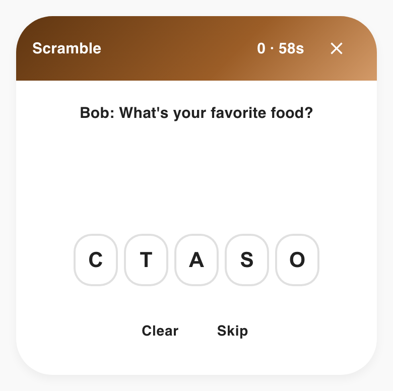
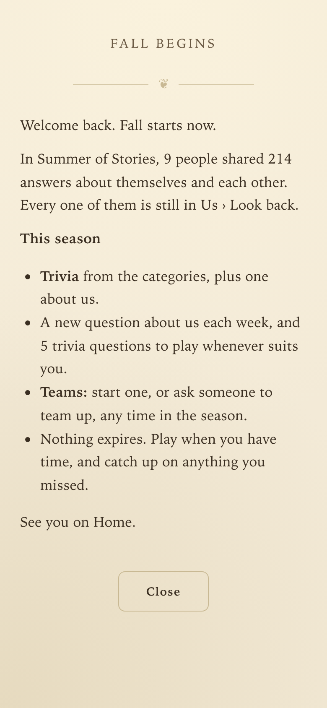
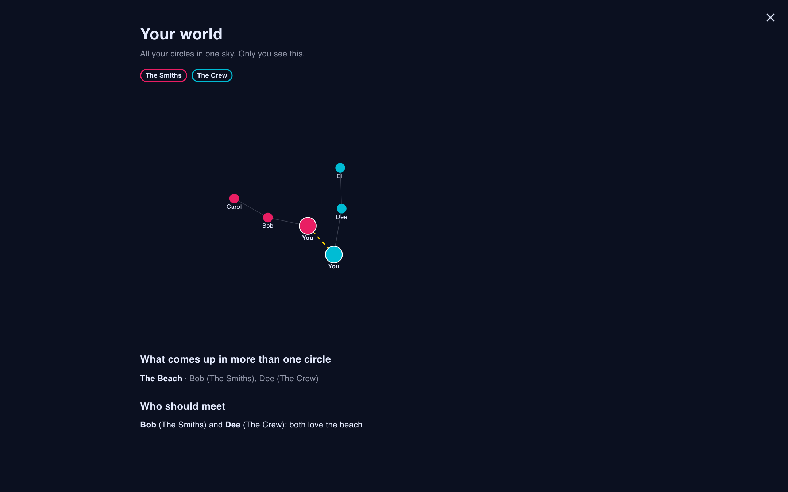
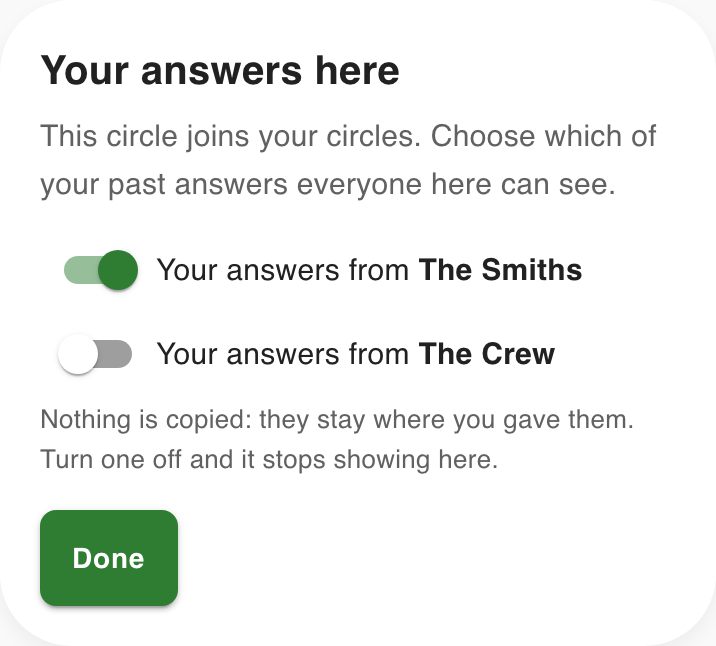
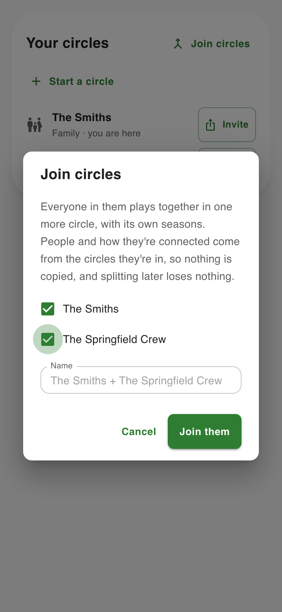
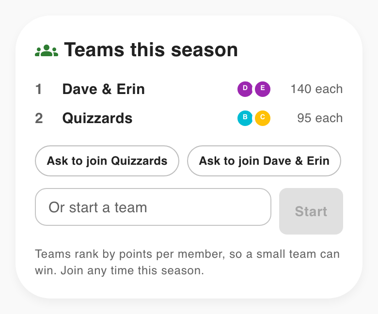
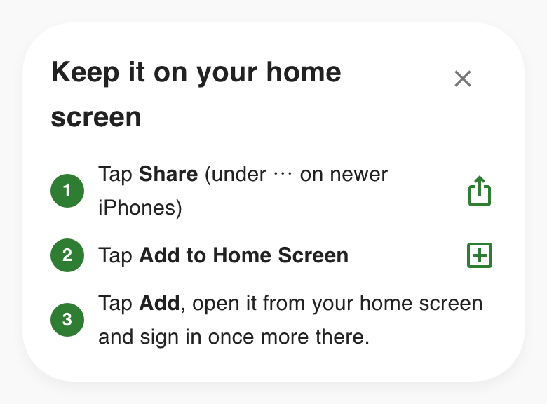

# A look around

Every picture is taken from a Storybook story with made-up people, listed in [`screenshots/shots.json`](screenshots/shots.json). `just screenshots` retakes them, and `just check` fails when a pictured story has changed since its picture was taken.

Back to the [README](../README.md).

## A question a day

_Today's question, with a microphone hint for people who'd rather talk_

_What do you want to play: special challenges and categories_

_On this day, two years ago: everyone's answers to the same question_

## Games that earn a multiplier

_Casino Rush: triple or nothing_

_Slot Machine_

_Curling_

_Tetris_

_Top players: the season's podium_

_Scramble: unscramble an answer from the circle's own trivia_

## Everyone's story, told by the family

_A profile told as a story_

_Spotlight: one person a day_

_Fill in your story: one more for the family's story_

## Our map, and the family as a night sky

_Our map: what the family talks about, as territories_

_The family as a night sky: ties, partners and who answered alike_

## Look back, and keep it as a book

_Look back on a season_

_A season as a book: how it's written, and every version kept_

## Remembering

_Remembering: the last things they told us_

## Family, friends, or both

_Circles: a family and two circles of friends, one sign-in_

## Run by the family, in its own account

_Settings: an AI model per task, with real costs_

## Inviting people

_An invite link: the circle, a name, then Google_

_Admin › Circles: someone waiting to join, a new link, and the links already out_

## Friends, connected

_Threads: how do you know Bob? One tap_

_A friend's connections: how and when they met each friend_

## Memories from everyone who knew them

_A memory link: no account, just a name and a memory_

## Play as time allows

_A season opens: a welcome, last season in a line, and what this one is_

## Your world

_Your world: two circles, you between them, and who should meet_

## Joining circles

_Your answers here: a switch for each of your circles_

_Joining circles: pick two or more, and it's named after them_

## Teams

_Teams: ask to join, team up, or start one, and the standings_

## What's on

_What's on: the next two weeks, the best days, and a hike people are in for_

## Your picture

_Your picture: one made for you, or an animal and its color_

## On your home screen

_Adding it to the home screen on an iPhone_
